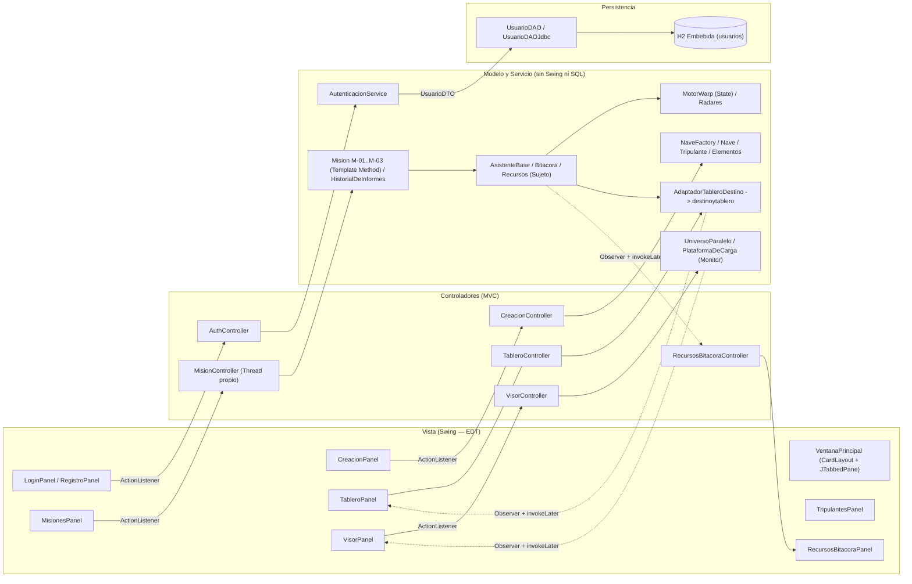
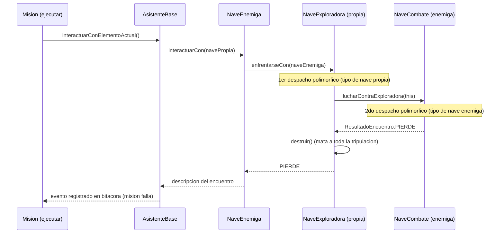
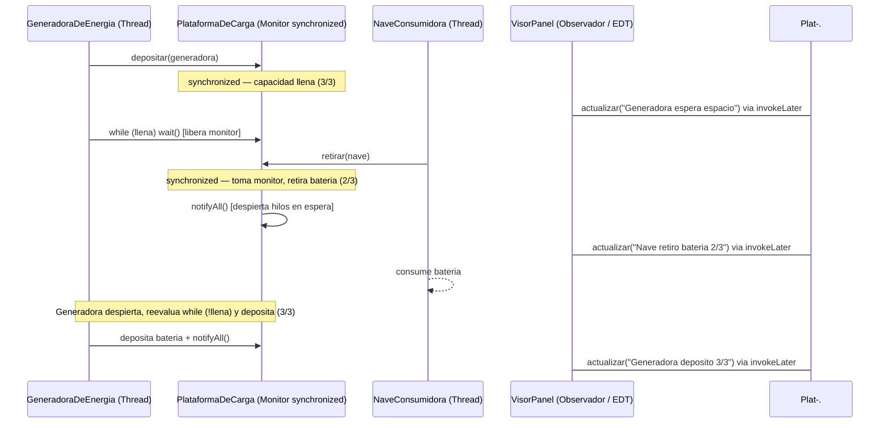
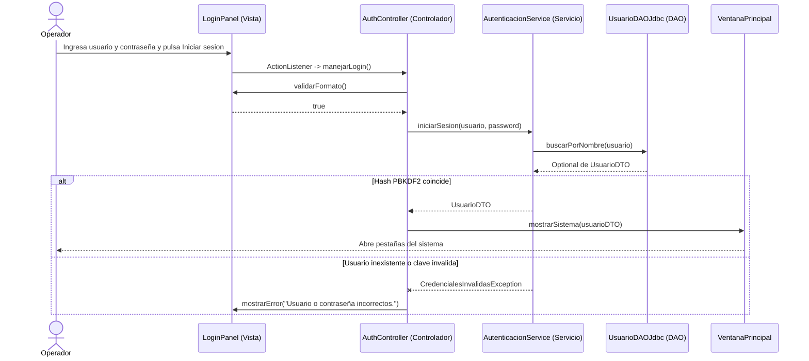
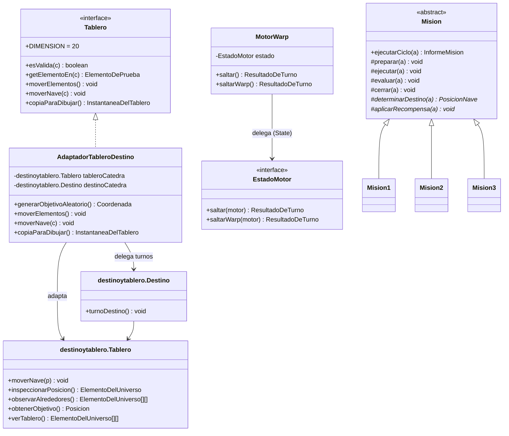

# Diagramas de Arquitectura y Patrones — Entrega 2

Estos diagramas complementan el diagrama general de la Entrega 1 ([`diagrama_uml_tpg_e1.png`](diagrama_uml_tpg_e1.png)) y el diagrama PlantUML actualizado de la Entrega 2 ([`diagrama_uml_tpg_e2.puml`](diagrama_uml_tpg_e2.puml)), aislando los patrones y flujos clave solicitados para la segunda etapa y la exposición.

---

## 1. Arquitectura MVC + Observer (Interfaz Gráfica y Capas)

---

## 2. Secuencia — Double Dispatch en Encuentros entre Naves

---

## 3. Secuencia — Concurrencia Productor–Consumidor (`wait()` / `notifyAll()`)

---

## 4. Secuencia — Control de Acceso MVC + Persistencia DAO/DTO

---

## 5. UML Enfocado — Tablero Oficial (Adapter), Motor Warp (State) y Misiones (Template Method)

